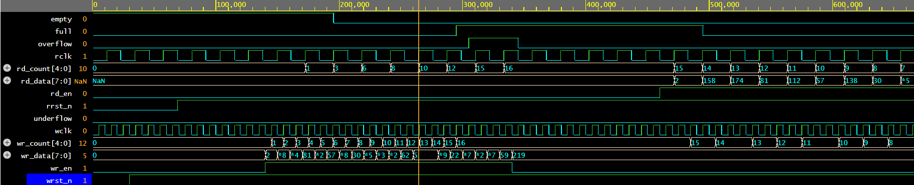
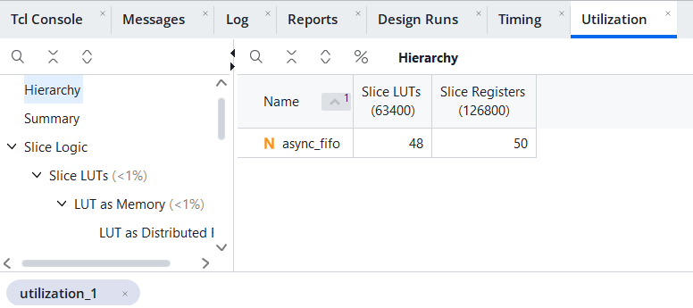
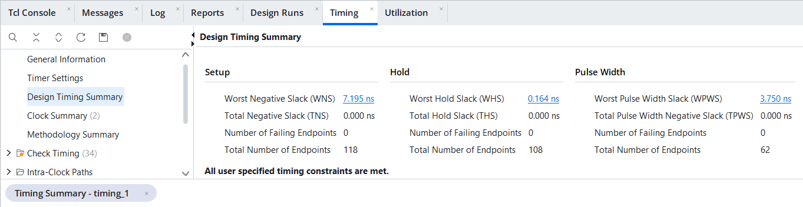
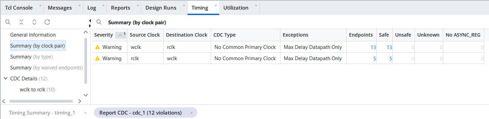

# Asynchronous (Dual-Clock) FIFO with CDC and SystemVerilog Assertions

A parameterized asynchronous FIFO in SystemVerilog that safely passes data
between two **unrelated clock domains**. Clock domain crossing (CDC) is handled
with **Gray-code pointers** and **2-flop synchronizers** (Cummings-style
architecture). It is verified with a self-checking testbench running three
different clock ratios, a reference-model scoreboard, per-domain functional
coverage and 22 SVA properties attached through `bind`.

## Features

- Independent write clock (`wclk`) and read clock (`rclk`) with separate resets
- Parameterized `DATA_WIDTH` and `DEPTH` (power of 2, >= 4)
- Gray-code pointers + 2-flop synchronizers for CDC (`ASYNC_REG` attribute for Vivado)
- Registered `full` / `empty`, computed from next-state pointers (no extra latency)
- Fill level visible on each side: `wr_count` (writer's view) and `rd_count` (reader's view)
- `overflow` / `underflow` pulses for illegal accesses (safely ignored)
- Registered read data (1 `rclk` latency); memory has no reset, so it maps to FPGA RAM
- CDC timing constraints (`set_max_delay -datapath_only`) instead of blanket false paths

## Block Diagram

```
   WRITE CLOCK DOMAIN (wclk)                      READ CLOCK DOMAIN (rclk)

 wr_en ─►┌───────────────┐  wr_data  ┌───────────┐  rd_data  ┌───────────────┐◄─ rd_en
         │   wptr_full   │──────────►│ fifo_mem  │──────────►│  rptr_empty   │
 full ◄──│ bin + Gray ptr│  waddr    │ dual-port │  raddr    │ bin + Gray ptr│──► empty
         │   full logic  │──────────►│  memory   │◄──────────│  empty logic  │
         └──────┬────────┘           └───────────┘           └───────┬───────┘
                │ wptr (Gray)                                rptr (Gray) │
                │          ┌──────────────────────┐                     │
                └─────────►│ sync_2ff (into rclk) │── rq2_wptr ────────►│
                           └──────────────────────┘                     │
                ◄── wq2_rptr ┌──────────────────────┐                   │
                             │ sync_2ff (into wclk) │◄──────────────────┘
                             └──────────────────────┘
```

## File Structure

```
async_fifo/
├── rtl/
│   ├── async_fifo.sv      # Top level
│   ├── fifo_mem.sv        # Dual-port memory
│   ├── sync_2ff.sv        # 2-flop synchronizer
│   ├── wptr_full.sv       # Write pointer + full flag (wclk)
│   └── rptr_empty.sv      # Read pointer + empty flag (rclk)
├── sva/async_fifo_sva.sv  # Assertions + bind
├── tb/tb_async_fifo.sv    # Self-checking testbench
├── constraints/async_fifo.xdc  # Clocks + CDC constraints for Vivado
├── sim/run_questa.do      # Questa/ModelSim script
├── sim/run_xsim.sh        # Vivado xsim script
└── README.md
```

## Interface

| Signal      | Dir | Domain | Width         | Description                                        |
|-------------|-----|--------|---------------|----------------------------------------------------|
| `wclk`      | in  | write  | 1             | Write clock                                        |
| `wrst_n`    | in  | write  | 1             | Async active-low reset (write side)                |
| `wr_en`     | in  | write  | 1             | Write request                                      |
| `wr_data`   | in  | write  | DATA_WIDTH    | Write data                                         |
| `full`      | out | write  | 1             | No free space (may be pessimistic, never optimistic) |
| `wr_count`  | out | write  | log2(DEPTH)+1 | Fill level seen by writer (>= true level)          |
| `overflow`  | out | write  | 1             | 1-cycle pulse: write attempted while full          |
| `rclk`      | in  | read   | 1             | Read clock                                         |
| `rrst_n`    | in  | read   | 1             | Async active-low reset (read side)                 |
| `rd_en`     | in  | read   | 1             | Read request                                       |
| `rd_data`   | out | read   | DATA_WIDTH    | Read data, valid 1 `rclk` after an accepted read   |
| `empty`     | out | read   | 1             | No data (may be pessimistic, never optimistic)     |
| `rd_count`  | out | read   | log2(DEPTH)+1 | Fill level seen by reader (<= true level)          |
| `underflow` | out | read   | 1             | 1-cycle pulse: read attempted while empty          |

## Design Notes

**Why Gray code?** A binary counter can change several bits at once
(7 → 8 is `0111 → 1000`). If the other clock samples during that change it can
see a completely wrong value. A Gray counter changes exactly one bit per
increment, so a sampled pointer is always either the old or the new value.

**Why two flip-flops?** The first synchronizer flop may go metastable when its
input changes near the clock edge. The second flop gives it a full clock period
to settle, which makes the probability of failure (MTBF) negligible.

**Full and empty.** Pointers are one bit wider than the address.
- *Empty* (read domain): next Gray read pointer == synchronized Gray write pointer.
- *Full* (write domain): next Gray write pointer == synchronized Gray read pointer
  with its **two MSBs inverted** (Gray-code equivalent of "same address, one more wrap").

**Pessimistic flags (by design).** Each side sees the other pointer about two
clock cycles late. So `full` can stay set a little after a read has made room,
and `empty` can stay set a little after a write has added data. The FIFO is
therefore never overwritten and never read when empty; it only loses a few
cycles of throughput. `wr_count` / `rd_count` are pessimistic in the same way.

**Why depth must be a power of 2.** The Gray-code sequence only wraps with a
single-bit change when the counter wraps at a power of 2.

**Reset.** Assert `wrst_n` and `rrst_n` together and release each synchronously
to its own clock. In a full system a reset synchronizer would generate them.

**CDC constraints.** `set_max_delay -datapath_only` bounds the pointer and memory
crossing paths so all bits of a Gray pointer arrive within one clock period of
each other. A plain `set_false_path` or `set_clock_groups -asynchronous` would
leave the bit-to-bit skew unconstrained.

## Verification

### Testbench (`tb/tb_async_fifo.sv`)

- **Scoreboard:** a SystemVerilog queue models the FIFO. Every read is checked
  for correct data and order. The checkers also confirm that `wr_count` never
  under-reports and `rd_count` never over-reports the real fill level.
- **Two independent clocks**, with the clock ratio changed between phases.

| Test | Scenario                                                              |
|------|-----------------------------------------------------------------------|
| T1   | Reset state                                                           |
| T2   | Fill to full with no reads: exactly DEPTH writes accepted, then overflow attempts |
| T3   | Reader sees all DEPTH entries, drains to empty, then underflow attempts |
| T4   | Random traffic, fast write (100 MHz) / slow read (~43 MHz)            |
| T5   | Random traffic, slow write (~37 MHz) / fast read (125 MHz)            |
| T6   | Random traffic, near-equal clocks with drifting phase (100 / ~93 MHz) |
| T7   | Reset while the FIFO holds data (checked non-empty), then more traffic |

- **Functional coverage:** one covergroup per clock domain (request × flag,
  and fill-level bins empty / low / high / full).
- **Seed control:** `+SEED=<n>`.

### Assertions (`sva/async_fifo_sva.sv`)

| Category                 | Properties checked                                                  |
|--------------------------|---------------------------------------------------------------------|
| Reset                    | Pointers zero, `full`=0, `empty`=1, no error pulses during reset    |
| Gray-code correctness    | Each Gray pointer changes at most one bit per clock                 |
| Pointer behaviour        | Pointers advance only on accepted operations, hold when full/empty  |
| Overflow / underflow     | Pulses set exactly when an illegal access is attempted              |
| Fill levels              | `wr_count` / `rd_count` never exceed DEPTH                          |
| X-checks                 | No X/Z on outputs, or on `rd_data` after a read                     |
| **Cross-domain safety**  | Using the real pointers: no write is accepted when truly full, no read when truly empty |
| Cover properties         | full, write-when-full, full released, read-when-empty, empty released, reader sees full |

## How to Run

**EDA Playground:** paste the five `rtl/` files and `sva/async_fifo_sva.sv` into
the Design box and `tb/tb_async_fifo.sv` into the Testbench box. Set Top module to
`tb_async_fifo`, choose Siemens Questa, tick "Open EPWave after run".

**Questa / ModelSim:**
```
cd sim
vsim -c -do run_questa.do
```

**Vivado simulator:**
```
cd sim
sh run_xsim.sh
```

**Vivado synthesis:** add the five `rtl/` files as design sources and
`constraints/async_fifo.xdc` as the constraint file, top = `async_fifo`,
synthesis option `-mode out_of_context`. After synthesis, run
*Reports → Timing → Report CDC* to see the synchronizers recognised.

## Results

| Metric                         | Value |
|--------------------------------|-------|
| Simulator                      | Questa 2025.2 (EDA Playground) |
| Clock ratios tested            | 3 (fast write, fast read, near-equal drifting) |
| Writes / reads checked         | 4,045 / 4,029 (16 flushed by mid-traffic reset) |
| Scoreboard errors              | 0 |
| Assertion failures             | 0 (22 assertions, 6 cover properties) |
| Functional coverage            | 100 % write domain / 100 % read domain |
| FPGA part                      | xc7a100tcsg324-1 (Arty A7-100T) |
| Synthesis tool                 | Vivado (post-synthesis, out-of-context) |
| Slice LUTs / FFs               | 48 / 50 |
| Timing (wclk 10 ns, rclk 12.5 ns) | WNS +7.195 ns, WHS +0.164 ns, all constraints met |
| Report CDC                     | 18 crossing endpoints, all Safe (0 unsafe, 0 missing ASYNC_REG) |






Full simulation log: [sim/sim_log.txt](sim/sim_log.txt)

## Reference

C. E. Cummings, *"Simulation and Synthesis Techniques for Asynchronous FIFO
Design"*, SNUG 2002.
